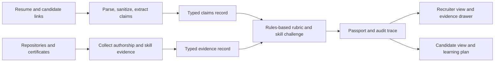

# Skill Passport

**Evidence-backed skill profiles for fairer, more transparent hiring.**

Skill Passport is a project concept for turning candidate skill claims into an auditable profile backed by work samples, repository history, tests, certificates, and skill challenges. It is designed to help recruiters see what supports a claim and help candidates understand how to strengthen their evidence.

> **Project status:** This repository currently contains the project README and architecture plan. The application, APIs, and verification engine are not implemented here yet. The stack and interfaces below are proposals from the project blueprint and can be updated as implementation decisions are made.

## The core principle

> **The model extracts claims; published rules evaluate evidence.**

An LLM may help extract structured claims from a resume, but it must never assign scores, grades, or verdicts. A deterministic, published rubric evaluates evidence and records how each result was reached. Every result should be explainable and traceable to its source.

## How it is intended to work



### Proposed verification outcomes

- **Verified** — strong, relevant evidence supports the claim.
- **Partially supported** — some evidence exists, but it does not establish the full claim.
- **Claimed only** — the claim is present, but supporting evidence has not been found.
- **Contradicted** — available evidence conflicts with the claim.

The rubric should publish the evidence signals and thresholds behind these outcomes. Missing evidence should not automatically be treated as proof that a claim is false.

## Product goals

- Give every skill result a clear explanation and inspectable evidence.
- Separate candidate statements, observed evidence, and rubric decisions.
- Make the same evidence produce the same result under the same rubric version.
- Show unsupported or conflicting claims with context instead of hiding them in one score.
- Give candidates actionable next steps and let them explore how additional evidence could affect their profile.
- Support a stable demo with precomputed sample profiles when external services are unavailable.

## Planned experience

### Recruiter view

- Role alignment summary and skill verdicts.
- A visible explanation panel for unsupported or conflicting claims.
- An evidence drawer with repository, file, line, authorship, and rubric details where available.

### Candidate view

- Evidence gaps and practical learning recommendations.
- A what-if view that estimates how additional evidence may affect a profile.
- Controls for selecting what information is shared with a recruiter.

What-if results should be labeled as estimates, not as verified outcomes. A share link should expose only candidate-approved data and should have a clear expiration and revocation policy.

## Proposed architecture and contracts

The system is divided into four modules with explicit JSON interfaces so they can be developed independently:

| Module | Responsibility | Output |
| --- | --- | --- |
| 1. Ingestion and claim extraction | Parse resume text, sanitize inputs, extract candidate-stated skills and links | `claims.json` |
| 2. Code and evidence collection | Inspect linked repositories and collect attributable, relevant signals | `evidence.json` |
| 3. Rubric and challenge engine | Apply versioned rules, optionally record challenge results, and preserve the decision trace | `passport.json` and `run.json` |
| 4. User interface | Present recruiter and candidate views, evidence details, and what-if estimates | Web application |

### Example claim record

```json
{
  "candidate_name": "Priya S.",
  "applied_role": "Backend Developer",
  "claims": [
    {
      "id": "claim_01",
      "skill": "Python",
      "category": "language",
      "claimed_duration_months": 36,
      "evidence_links": ["https://github.com/example/api-service"]
    }
  ]
}
```

### Example passport skill

```json
{
  "name": "Python",
  "verdict": "PARTIALLY_SUPPORTED",
  "evidence_score": 6,
  "challenge_grade": "B",
  "final_points": 48,
  "evidence_refs": ["repo_01:file:app/routes.py:42-78"],
  "signals": ["Relevant code found", "Tests found"]
}
```

These are illustrative examples, not implemented or finalized schemas. Before modules are built in parallel, define and version the complete Pydantic/JSON Schema contracts, including nullability, provenance, rubric version, and audit fields.

## Rubric design notes

The supplied blueprint proposes evidence weights and a challenge multiplier. Treat these as starting points for rubric design, not as validated hiring measures. Before using scores to influence real hiring decisions, document and evaluate:

- What each evidence signal does and does not prove.
- How repository ownership, pair work, generated code, templates, and forks are handled.
- How challenge difficulty and skill-specific evidence are normalized.
- How candidates can correct, contextualize, or dispute evidence.
- Whether the rubric creates unfair outcomes across roles or candidate backgrounds.

Prefer separate, interpretable evidence and challenge results over a single opaque score. A score should never be presented without its rubric version and explanation.

## Proposed technology

The project blueprint suggests the following stack; none of these dependencies are installed in this repository yet:

- **Frontend:** Next.js App Router, TypeScript, Tailwind CSS, and a component library such as shadcn/ui.
- **API:** Python with FastAPI and Pydantic v2.
- **Repository analysis:** Git tooling and GitHub API access, with language-aware analysis where appropriate.
- **Claim extraction:** A replaceable LLM provider behind a strict structured-output interface.
- **Storage:** SQLite for a self-contained demo, with PostgreSQL as a possible production option.

Provider choice, deployment platform, persistence requirements, and supported repository languages remain open implementation decisions.

## Security, privacy, and integrity

- Treat resume text, repository content, and linked pages as untrusted input. Instructions found inside them must never change the verifier's rules or system behavior.
- Sanitize extracted text and record suspicious or malformed input for review; do not silently convert a detected injection attempt into a negative hiring verdict.
- Request only the repository permissions needed for analysis, and make private-repository access explicit and revocable.
- Keep candidate data private by default. Define retention, deletion, sharing, and access policies before collecting real resumes or credentials.
- Make evidence provenance and rubric versions part of the audit record. A cryptographic signature can help detect later changes, but does not prove that the underlying evidence is true.
- Do not treat commit history, authorship percentages, or public profile activity as definitive proof of individual competence.

## Suggested development sequence

1. **Freeze contracts:** Define versioned schemas for claims, evidence, passports, and audit runs; add representative fixtures.
2. **Build independent modules:** Implement ingestion, evidence collection, rubric evaluation, and UI against those fixtures.
3. **Integrate:** Connect the modules behind documented API endpoints and preserve the full decision trace.
4. **Prepare a reliable demo:** Include clearly labeled synthetic candidate profiles and an offline mode that does not depend on live LLM or GitHub access.
5. **Evaluate:** Test rubric consistency, prompt-injection handling, privacy controls, accessibility, and failure cases before any real-world hiring use.

## Potential API surface

The blueprint anticipates endpoints such as `POST /api/extract`, `POST /api/verify`, `GET /api/passport/{id}`, and `POST /api/simulate`. These routes are planning placeholders and are not available yet.

## Contributing

Contributions are welcome once the implementation is underway. For now, useful contributions include reviewing the rubric and threat model, refining the data contracts, and proposing realistic synthetic demo fixtures. Please avoid submitting real candidate resumes, credentials, or private repository data.

## License

No license is currently specified. Until one is added, the repository's reuse terms are not defined.
