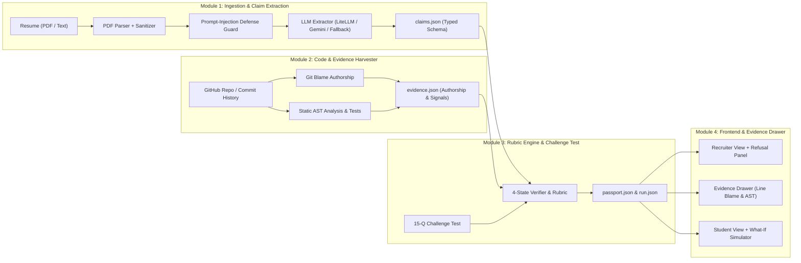

# Skill Passport: Verifiable Ground-Truth Competency Engine

> **The Golden Rule**: *"LLM extracts text, published rules score evidence."*  
> The LLM never assigns scores, grades, or verdicts. Every claim is mapped to verifiable ground-truth evidence (git authorship, AST tests, certificates, or question challenges) and evaluated against a published, auditable rubric.

---

## 🏗️ 4-Person Decoupled Architecture



---

## 👥 Module Ownership & Contracts

### 👤 Member 1: Resume Ingestion, Extraction & Prompt-Injection Defense
- **Path**: `backend/app/module1_extractor/`
- **Responsibilities**:
  - `pdf_parser.py`: Extracts text and embedded hyperlinks from PDF bytes or markdown/plain text resumes.
  - `injection_guard.py`: Detects and neutralizes prompt injections (`SYSTEM OVERRIDE`, jailbreaks), zero-width characters (`\u200b`, `\u200c`), and hidden white-on-white text tags.
  - `llm_extractor.py`: Extracts declared skills, claimed experience duration, leadership claims, and repository links into strict `claims.json`. Includes offline fallback for 100% demo uptime.
- **Contract**: `claims.json` (`ClaimsDocument`)

### 👤 Member 2: Code Evidence Harvester & Git Blame Analyzer
- **Path**: `backend/app/module2_harvester/`
- **Responsibilities**:
  - `git_crawler.py`: Crawls git commit logs, extracts commit spans, and runs git blame on source files (excluding vendor/locks) to calculate candidate line authorship %.
  - `ast_analyzer.py`: Performs AST inspection to detect framework imports (FastAPI, React, Pytest), route definitions, and robust error handling (`try/except`).
  - `test_detector.py`: Scans for test suites (pytest, unittest, jest), counts test files and assertions.
  - `fork_detector.py`: Identifies forks, tutorial templates, single-day commit dumps, and low-authorship repositories.
- **Contract**: `evidence.json` (`EvidenceDocument`)

### 👤 Member 3: Deterministic Rubric Scoring, 4-State Verifier & Challenge Engine
- **Path**: `backend/app/module3_rubric/`
- **Responsibilities**:
  - `verifier.py`: Evaluates claims vs evidence using the 4-State Verdict Engine:
    - **VERIFIED**: Code authorship > 70% + sustained commits + tests/PR.
    - **PARTIALLY_SUPPORTED**: Valid certificate or quiz pass, but little production code.
    - **CLAIMED_ONLY**: Listed on resume, zero code evidence or tests found.
    - **CONTRADICTED**: Evidence actively disproves claim (e.g. sole committer claiming 5-person team; forked repo with 4% code claiming 5 years experience).
  - `scoring_engine.py`: Published Rubric Formula:  
    $$\text{Evidence Score (0–10)} \times \text{Challenge Grade Weight (2–10)} = \text{Skill Points (up to 100)}$$
    - *Evidence Weight*: Merged PR / Deployed (10) > Tests (8) > Commits (7) > Certificate (4) > Resume Only (2)
    - *Grade Weight*: A (10), B (8), C (6), D (4), E (2)
  - `question_bank.py`: 15-question quiz (5 Basic, 5 Intermediate, 5 Advanced) for technical validation.
  - `audit_tracer.py`: Generates `run.json` execution trace for every rule checked.
  - `crypto_signer.py`: Generates tamper-proof SHA-256 fingerprint for passport verification.
- **Contracts**: `passport.json` (`PassportDocument`) and `run.json` (`RunAuditLog`)

### 👤 Member 4: Frontend (Recruiter View, Evidence Drawer, Student Portal & What-If)
- **Path**: `frontend/`
- **Features**:
  - **Recruiter View**: Role match gauge (72%), competency cards with colored status badges, and the Refusal Panel ("Claims we couldn't support").
  - **Evidence Drawer**: Slide-over drawer with line-by-line blame preview, code snippet, git blame % bar, and micro-trace audit log.
  - **Student View**: Actionable Learning Plan and interactive **What-If Simulator** (toggling "Add pytest tests" updates role match live from 72% $\rightarrow$ 81%).
  - **Security Modal**: Demonstrates quarantine of prompt injections and zero-width unicode steganography attacks.
  - **15-Question Challenge Test**: Interactive quiz modal with automatic grading.
  - **Offline Demo Mode**: Instant switcher for 4 personas (Priya S., Alex R., Jordan K., Red-Team Adversary).

---

## 🚀 Quickstart Guide

### 1. Prerequisites
- Python 3.10+
- Node.js 18+ and npm

### 2. Backend Setup
```bash
# From workspace root
source venv/bin/activate
pip install -r backend/requirements.txt

# Run all 18 backend tests
PYTHONPATH=backend pytest backend/tests/

# Start FastAPI server
PYTHONPATH=backend uvicorn app.main:app --host 127.0.0.1 --port 8000
```

### 3. Frontend Setup
```bash
# From frontend directory
cd frontend
npm install
npm run dev -- --port 3000
```
Open [http://localhost:3000](http://localhost:3000) in your browser.

---

## 🧪 Test Suite Coverage

Run the comprehensive automated test suite across all 4 modules:
```bash
PYTHONPATH=backend pytest backend/tests/ -v
```

Tests include:
- `test_module1.py`: Prompt injection sanitization, zero-width unicode stripping, and typed claims extraction.
- `test_module2.py`: Git blame author calculation, AST parsing, pytest assertion detection, and fork template detection.
- `test_module3.py`: 4-state verdict logic, rubric scoring formula, 15-question quiz grader, SHA-256 signer, and What-If simulator.
- `test_integration.py`: End-to-end FastAPI endpoint validations for all demo personas.
